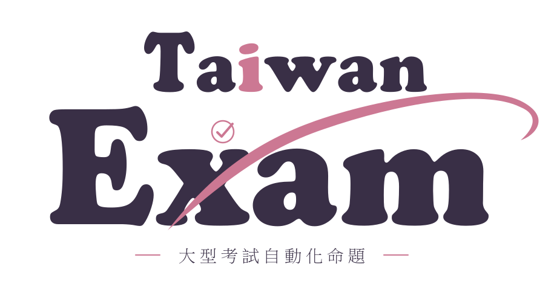

<div align="center">

<picture>
  <source media="(prefers-color-scheme: dark)" srcset="../assets/readme/wordmark-dark.svg">
  
</picture>

[學測（目前可用）](../../README.md#支援的考試與科目) · **會考** · [分科測驗](subject-test.md)

</div>

# 會考

**測試中：會考六本題本的版型、校準資料與出卷流程已完成，正在進行完整考卷實測。**

| 項目 | 目前狀態 |
| :-- | :-- |
| 科目 | 國文、英語（閱讀）、數學、社會、自然、寫作測驗（英語聽力需要音檔，不製作） |
| 卷型與題數 | 依 113–115 年正式題本量測：國文 42 題、英語閱讀 43 題、數學 25 題選擇＋2 題非選、社會 54 題、自然 50 題、寫作 1 題 |
| 難度校準 | 113–115 年官方「各題通過率」逐題資料 |
| 固定版型 | 封面、內頁頁碼、「請翻頁繼續作答」、數學參考公式頁（A4 列印） |
| 出卷流程 | 與學測共用同一套命題、驗算、組版與逐頁檢查 |
| 完整考卷實測紀錄 | 待建立 |

## 怎麼出會考卷

安裝方式與學測相同（同一個 Skill ZIP）。開新對話選取 Skill 後貼上，例如：

```text
請用 taiwan-exam-generator 出一份會考社會模擬考，交付題本 PDF 與答案詳解 PDF。
```

科目可換成國文、英語、數學、自然或寫作測驗。

**難度可以自己選**：在出卷文字加上「難度：中」（可選 低（會考）／中／高／極難；不寫就是會考難度）。
會考難度是下限，越高越難；但不論哪一級都**不超出國中課綱**，每題都能用學過的知識一步步推出，
詳解會寫出完整推導過程。

```text
請用 taiwan-exam-generator 出一份會考自然模擬考，難度：高，交付題本 PDF 與答案詳解 PDF。
```

品質以正式會考為下限：素養導向的真實生活情境、依官方鑑別度設計的誘答選項、承載答題證據的清楚圖表。

交付檔名例如
`會考_社會_20261110-01_題本.pdf`、`會考_社會_20261110-01_詳解.pdf`。

卷型細節見 [current-cap-form.md](../../references/current-cap-form.md)。

[返回專案首頁](../../README.md) · [查看更新紀錄](../web-updates.md)
